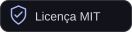
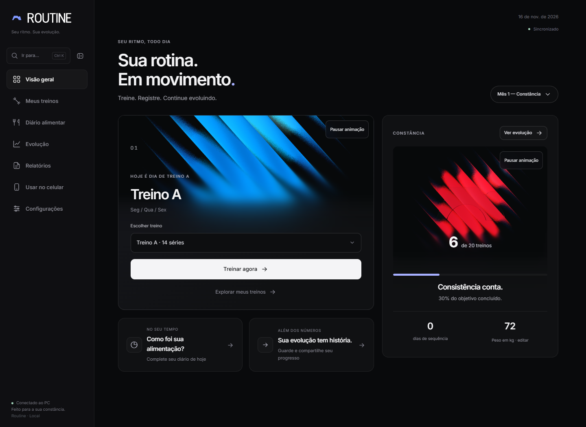
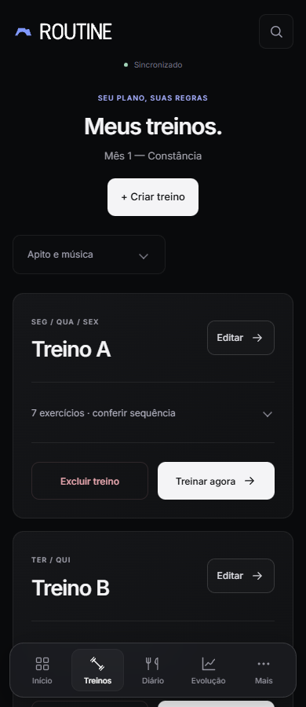
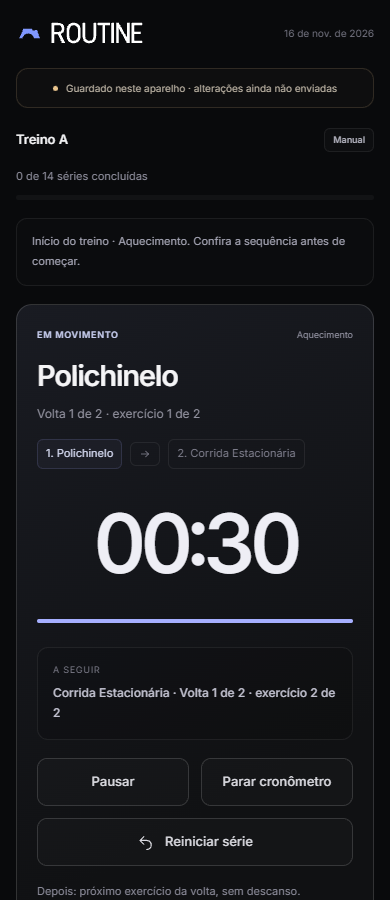
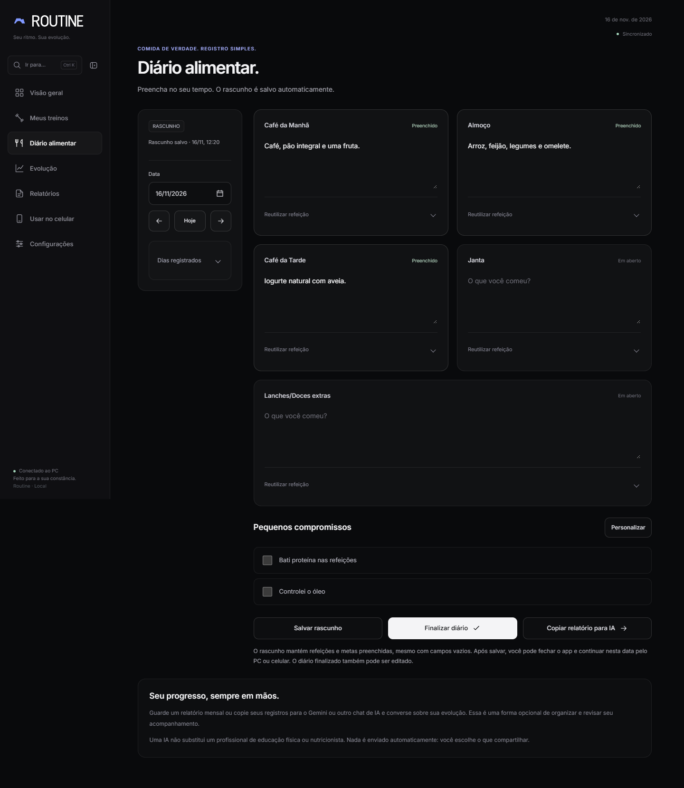

<p align="center">
  
</p>

<p align="center">
  <strong>Um espaço seu para treinar, registrar e continuar evoluindo.</strong><br>
  Feito a partir da minha rotina. Compartilhado para fazer parte da sua também.
</p>

<p align="center">
  <a href="#instalar"></a>
  <a href="#usar-no-celular"></a>
  <a href="LICENSE"></a>
</p>

<p align="center">
  <a href="#o-projeto">O projeto</a> ·
  <a href="#funcionalidades">Funcionalidades</a> ·
  <a href="#por-dentro-do-routine">Capturas</a> ·
  <a href="#instalar">Instalação</a> ·
  <a href="#usar-no-celular">Celular</a> ·
  <a href="#desenvolvimento">Desenvolvimento</a>
</p>

---

<h2 align="center">O projeto</h2>

Criei o **Routine** como um projeto pessoal para organizar meus treinos de calistenia, anotar as refeições do dia e acompanhar meu progresso em um só lugar. A ideia é simples: ter menos coisas para administrar e mais clareza para manter a constância.

Resolvi compartilhar o projeto porque ele pode ser útil para outras pessoas também, especialmente para quem pratica **calistenia** e quer montar uma rotina própria. Você pode adaptar os treinos, seguir cada série no seu tempo e voltar aos registros para entender como está evoluindo.

O aplicativo roda no **Windows**, com acesso pelo navegador do **celular** na mesma rede. Os registros ficam no seu PC, sem precisar criar uma conta. É um projeto pessoal em evolução; sugestões, relatos de uso e contribuições são bem-vindos.

<h2 align="center">Funcionalidades</h2>

| Para o seu dia a dia                    | O que você encontra                                                                                                                                                                     |
| :-------------------------------------- | :-------------------------------------------------------------------------------------------------------------------------------------------------------------------------------------- |
| **Treinos do seu jeito**                | Crie treinos A, B, C… e defina exercícios, séries, metas, descansos e dias da semana. A tela inicial sugere o treino agendado para o dia.                                               |
| **Execução no seu ritmo**               | Exercícios por repetições aguardam sua confirmação. Nos exercícios por tempo, use os cronômetros e o avanço automático. Pause, reinicie uma série ou ajuste o descanso quando precisar. |
| **Resultados que podem ser corrigidos** | Revise o treino concluído e edite os resultados de cada série, inclusive depois da sessão.                                                                                              |
| **Diário alimentar simples**            | Anote o que comeu em cada refeição, salve um rascunho e complete o restante mais tarde. Reutilize refeições e guarde favoritos.                                                         |
| **Evolução e ciclos**                   | Acompanhe sessões, metas e histórico. Registre peso e percepções de forma opcional, preservando os resultados ao iniciar outro ciclo.                                                   |
| **Relatórios à mão**                    | Consulte um dia, os últimos sete dias ou um mês completo. Leia a versão formatada, veja o Markdown e copie o texto para guardar ou compartilhar.                                        |
| **PC e celular juntos**                 | Abra pelo QR Code e treine no navegador, sem instalar APK. Também é possível continuar somente no celular, mantendo o serviço no PC.                                                    |
| **Ajustes e proteção dos registros**    | Teste apito e vibração, reduza animações e transparências, exporte backups e confira uma prévia antes de restaurar seus dados.                                                          |

O plano A/B incluído é um **exemplo editável**. Você pode usá-lo como ponto de partida para organizar o aplicativo ou criar seus próprios treinos.

<h2 align="center">Por dentro do Routine</h2>

<p align="center">
  
</p>

<p align="center"><sub>O treino do dia, seus registros e o progresso em uma visão geral.</sub></p>

<p align="center">
  <a href="docs/assets/screenshots/workouts-mobile.png"></a>
  <a href="docs/assets/screenshots/timer-mobile.png"></a>
</p>

<p align="center"><sub>Planeje no celular. Execute uma série de cada vez. Clique nas imagens para ampliar.</sub></p>

<details>
  <summary><strong>Ver o diário alimentar</strong></summary>

  <br>
  <p align="center"></p>

Anote uma refeição de cada vez. O rascunho permite continuar o preenchimento ao longo do dia, sem precisar finalizar tudo de uma vez.

</details>

<p align="center"><sub>As capturas usam dados fictícios de demonstração.</sub></p>

<h2 align="center">Instalar</h2>

<p align="center">
  <a href="https://github.com/gusynth/routine/releases"><strong>Ver versões e instalador para Windows →</strong></a>
</p>

1. Na página de **Releases**, procure uma versão publicada com o arquivo `Routine-<versão>-Setup.exe`.
2. Abra o instalador, confira a pasta de destino e escolha se deseja criar um atalho.
3. Conclua a instalação e clique em **Abrir Routine**.
4. Conheça o aplicativo, personalize seu plano e comece a registrar sua rotina.

Se ainda não houver um instalador publicado nas Releases, as instruções para compilar estão no [guia de desenvolvimento](docs/DEVELOPMENT.md).

O pacote Windows inclui Node.js e .NET: você não precisa instalar essas ferramentas separadamente para usar o aplicativo. Se o **WebView2** estiver ausente, o instalador explica como preparar o componente da Microsoft e pede sua confirmação. Essa etapa precisa de internet.

O instalador foi testado manualmente no Windows pelo autor. O executável **ainda não tem assinatura digital**, e a validação completa em Windows descartável permanece pendente. Consulte os detalhes em [instalação e validação](docs/INSTALLATION.md).

<h2 align="center">Usar no celular</h2>

O celular acessa o Routine que está rodando no seu PC. Não é necessário instalar outro aplicativo.

1. Conecte o **PC e o celular à mesma rede privada**.
2. No Routine do computador, abra **Usar no celular**.
3. Escaneie o QR Code com o telefone e abra o endereço no navegador.
4. Mantenha o PC ligado e o serviço do Routine ativo durante o uso.

Para deixar a janela do desktop de lado, use **Continuar somente no celular**. O serviço permanece no ícone perto do relógio do Windows. Fora desse modo, fechar o aplicativo também encerra o serviço local.

> [!IMPORTANT]
> O acesso local não tem login ou senha. Use uma rede privada confiável e não exponha o endereço à internet nem abra portas no roteador. Veja a [política de segurança](SECURITY.md).

**Treina ouvindo música?** Em **Configurações → Som e música**, teste o apito e as opções disponíveis no seu aparelho. Áudio, vibração e tela ativa dependem do dispositivo e do navegador; alertas em segundo plano ou com a tela bloqueada não são garantidos.

<h2 align="center">Seus registros ficam com você</h2>

Os dados salvos no PC ficam em `%LOCALAPPDATA%\Routine`, separados dos arquivos do programa. Rascunhos e recuperação de alterações também podem ficar no navegador do dispositivo utilizado; confira o estado de sincronização antes de fechar ou trocar de aparelho.

- **Exporte uma cópia** em **Configurações → Dados e backups**, especialmente antes de atualizar ou mudar de computador.
- **Confira antes de restaurar:** a importação mostra uma prévia e só altera os registros após sua confirmação.
- **Desinstale sem perder o histórico:** o desinstalador mantém os dados por padrão. Apagá-los é uma escolha separada, com confirmação adicional.

Backups no mesmo computador ajudam na recuperação, mas vale guardar uma cópia em outro local. Mais detalhes em [instalação e dados](docs/INSTALLATION.md).

<h2 align="center">Relatórios para guardar e compartilhar</h2>

Os relatórios reúnem os registros de um período em um texto fácil de consultar. Você pode manter uma anotação mensal do progresso, salvar o Markdown ou compartilhar um resumo por escolha própria.

A opção **Copiar relatório para IA** apenas coloca esse texto na área de transferência. O Routine **não envia seus registros automaticamente para nenhum chat de IA**. Essa função surgiu do meu uso pessoal para organizar e revisar anotações; ela é opcional e não é necessária para usar o aplicativo.

<h2 align="center">Desenvolvimento</h2>

O repositório contém o código-fonte. As instruções abaixo são para quem deseja executar ou modificar o projeto; quem usa o instalador não precisa segui-las.

<details>
  <summary><strong>Executar o projeto e compilar o desktop</strong></summary>

Requer **Node.js 22 ou superior**. Para compilar o desktop e o instalador, também é necessário Windows e SDK .NET 10; consulte os demais requisitos no [guia de desenvolvimento](docs/DEVELOPMENT.md).

```sh
npm ci
npm start
```

Abra `http://localhost:3000`. Para preparar a entrada de desenvolvimento do desktop:

```sh
npm run desktop:prepare
```

Para gerar o instalador:

```sh
npm run installer:build
```

Testes do aplicativo e do instalador:

```sh
npm test
npm run test:installer
npm run test:installer:ui
```

Use dados descartáveis nos testes. Os detalhes de compilação, organização e validação estão em [DEVELOPMENT.md](docs/DEVELOPMENT.md).

</details>

<details>
  <summary><strong>Estrutura do repositório</strong></summary>

| Pasta        | Conteúdo                                      |
| :----------- | :-------------------------------------------- |
| `public/`    | Interface web e mobile                        |
| `lib/`       | Persistência, backups e proteção de acesso    |
| `assets/`    | Identidade visual e recursos das cenas        |
| `desktop/`   | Janela Windows e controle interno do serviço  |
| `installer/` | Interface e mecanismo de instalação e remoção |
| `scripts/`   | Ferramentas de compilação e manutenção        |
| `test/`      | Testes com dados descartáveis                 |
| `docs/`      | Documentação e capturas de demonstração       |

</details>

<h2 align="center">Contribuir</h2>

O Routine é um projeto pessoal, mas pode crescer com outras experiências de uso. Relatos de bugs, sugestões para o treino de calistenia e melhorias de acessibilidade são bem-vindos. Veja o [guia de contribuição](CONTRIBUTING.md) antes de abrir uma proposta ou enviar código.

Ao relatar um problema, não publique seu banco, backups ou informações pessoais. Para dúvidas sobre exposição de dados, consulte [SECURITY.md](SECURITY.md).

<p align="center">
  <a href="docs/ROADMAP.md">Roadmap</a> ·
  <a href="CHANGELOG.md">Histórico de mudanças</a> ·
  <a href="docs/DIAGNOSTICS.md">Diagnóstico</a> ·
  <a href="THIRD_PARTY_NOTICES.md">Créditos</a>
</p>

<h2 align="center">Uso responsável</h2>

> [!NOTE]
> O diário alimentar foi pensado para **anotações simples das refeições do dia**. Ele não calcula suas necessidades nutricionais nem prescreve uma dieta.
>
> O uso opcional com IA reflete meu fluxo pessoal de organização, e não uma proposta de orientação nutricional ou de treino. As respostas podem conter erros e **não substituem o acompanhamento de nutricionistas ou profissionais de educação física**. O plano A/B incluído também é um exemplo editável, e não uma prescrição individualizada.

---

<p align="center">
  Projeto pessoal de <a href="https://github.com/gusynth">gusynth</a>.<br>
  Código sob <a href="LICENSE">licença MIT</a>. Dependências e materiais de terceiros mantêm suas próprias licenças.
</p>
